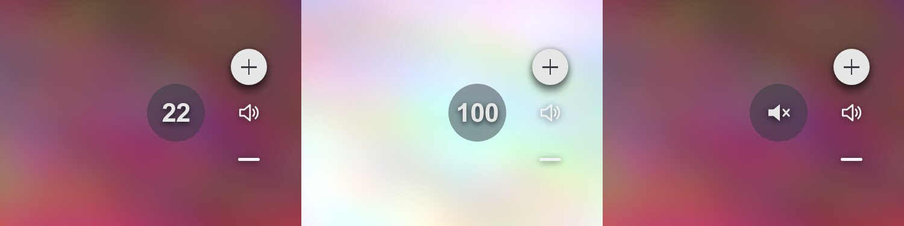
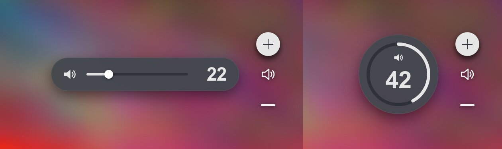
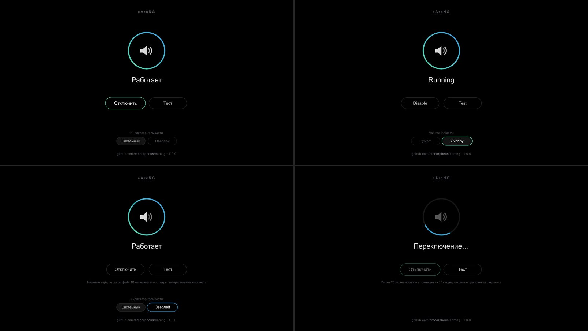

# eArcNG: real eARC soundbar volume on LG webOS

**English** · [Русский](README.ru.md)

Combines two MIT-licensed projects:

* [trk501/lg-soundbar-volume-osd](https://github.com/trk501/lg-soundbar-volume-osd): the CEC logic
  (`50:7A:xx` <Report Audio Status>, fast-tap guard via `05:45`) and the **QML patch of the system volume
  indicator** (webOS ≤ 10.x).
* [Nikolay1243/Webos-EARC-Volume-Overlay](https://github.com/Nikolay1243/Webos-EARC-Volume-Overlay):
  a transparent overlay window that does not take focus. eArcNG has its own app built on this technique
  (**eArcNG**, `com.github.emoorpheus.earcng`); Nikolay1243's app is not needed (without eARC volume its
  `watcher.js` shows the **TV's key-press counter**).

Only the value the soundbar itself reported over CEC is shown. There are two display modes:

| mode | where it works | what it looks like |
|------|----------------|--------------------|
| `ui native` (recommended on webOS ≤ 10.x) | QML compositor: `StarfishVolume.qml` exists | the **system** LG indicator: number and bar instead of "+/−", shows and hides by itself with native timings |
| `ui overlay` (default) | any firmware where the overlay app runs (webOS 11.x with Flutter not tested yet) | a separate overlay window: badge, pill or ring next to the native "+/−" column |

Tested (owner's field test): LG OLED65M59LA (webOS 25 = 10.3.0, QML, Python 3.10.13 on the TV) +
Sony HT-A8000 (eARC, logical address 5, reports volume 0…100 1:1). Both modes: numbers match the soundbar,
changes made from the Sony app are shown too; in `ui native` the system indicator shows the real number and bar
right on key press, with native timings.

## Features

* **`ui native`**: the real number in the system indicator (trk501's method, own code). No second window, no
  app-launch delay: the indicator appears immediately on key press and hides as usual.
  Switch: `./tools/earcng.sh root@TV ui native`, back: `ui overlay`.
* **Indicator choice on the TV**: System / Overlay buttons on the settings screen switch between `ui native` and
  `ui overlay`. The second press confirms (the TV interface restarts: open apps close, the screen may go black for
  ~15 s), then the settings screen opens again by itself and shows the result ("Done: the system indicator is
  on"); shown only when the bridge is running and the firmware has the QML compositor
  (see [Settings screen](#settings-screen)).
* **Own app eArcNG** (`com.github.emoorpheus.earcng`, with an icon in the app list): `install` builds its package
  on the TV and installs it with the system installer (`appInstallService`), no Homebrew Channel listing needed.
  It shows the overlay and the settings screen.
* **Install from Homebrew Channel** (1.1.0): add the eArcNG repository to Homebrew Channel, install the app there
  and press **Install** on its settings screen: the app package carries the backend
  (see [Install from Homebrew Channel](#install-from-homebrew-channel-110)).
* **Second volume source** (1.1.0, `--arc-source`): when the CEC bus brings no `50:7A` (no `/dev/cec*`, no
  access, the bus is silent), the bridge asks the TV's eARC service
  `luna://com.webos.service.eim/getArcVolume` (Nikolay1243's idea from v1.4.0). It is the soundbar's value as the TV
  knows it, not the TV's key-press counter.
* **Settings screen** in the eArcNG app: a status ring, one Enable/Disable button and Test, almost no text. Black
  background for OLED, details only when something is wrong, version and project link at the bottom. **English or
  Russian, following the TV language** (see [Language](#language)).
* **Overlay** (`ui overlay`): default look `badge` (Ø96 px circle left of the native ARC column, vertically
  centered), colors and shadow taken from the native indicator's metrics. It hides **1500 ms after the last key
  press** (like the native one; the bridge passes the key time `kt`), fade 150 ms; when it appears (cold app launch:
  on OLED65M59LA the window reached the screen ~0.5–1.5 s after the press), it stays the full 1500 ms from its first
  frame on screen.
* `--keepalive N` (experimental): the hidden overlay window lives N more seconds, so the next appearance needs no
  cold app launch.
* Native-mode safeguards: the patch is verified before mounting, rollback if the UI fails, CEC feedback guard
  and `setVolume` rejection guard; TV and soundbar mute are never touched.
* **`report`**: one command collects everything a GitHub issue needs (model, firmware, check, status, log; no TV
  address), and there is an issue form for it (see [Report a problem](#report-a-problem)).



## Why native is faster and more accurate

Measured from overlay-mode telemetry on this TV (`tests/fixtures/overlay-telemetry-m59la.log`):

* remote key press → TV frame `05:44` ≈ 100 ms; `05:44` → soundbar reply `7A` ≈ 157 ms (up to ~400 ms while
  holding; the soundbar skips some replies);
* every TV frame `05:44` = exactly ±1 on the soundbar (hold 16→27 = 11 frames, 26→11 = 15);
* after release the TV sends 1–2 more repeats ~250 ms apart.

The overlay is a separate web app: every appearance after hiding is an app launch, so it appears later than the
native "+/−". The system indicator appears on key press by itself, without launching anything. Its number
updates when the soundbar reply arrives (~0.25 s after the press); until then the previous real value is shown.

## How `ui native` works

```
 Remote ─ Vol± ─► TV: counter +1 (cause volumeUp) ──► system indicator appears (patch: does NOT take this number)
                  TV ─ 05:44 ─► Sony ─ 50:7A:xx ─► cec_volume_bridge.py
                                                       │ luna audio/master/setVolume {"volume": xx}
                                                       ▼
                  TV: counter = xx (cause setVolume) ─► indicator shows xx (real volume)
```

`backend/native-osd.sh apply` does the same as trk501's `60-volume-osd`: copies `StarfishVolume.qml` and
`StarfishVolumeView.qml` to `/tmp/cec-volume-qml`, applies its `sed` replacements and attaches the copies with
`mount --bind` (firmware files are not modified; after a reboot without the hook the original is back), then
restarts `surface-manager` (the screen goes dark for a few seconds). Replacements:

1. `exterior && !syncable` → `false`: number and bar are shown for ARC too, the "+/−" arrows go away;
2. the indicator shows `shownVolume` instead of the TV's live counter;
3. for an external output `shownVolume` only accepts values not caused by key presses (`cause` ≠
   `volumeUp/volumeDown`), i.e. the ones set by the bridge.

Bridge rules (as in trk501's `cec-sync.py`):

* after a key press: always `setVolume` (the TV counted the same value itself, but the indicator only takes
  `cause setVolume`);
* without a key press (Sony app, soundbar remote): only if the TV counter differs;
* TV or soundbar muted: touch nothing (`setVolume` would unmute); the skipped value is set right after unmute;
* until the `getVolume` subscription has reported the TV state: show the overlay.

Safeguards:

* the patch is mounted only if **all** replacements matched exactly as expected (trk501's check), otherwise
  `native OSD: not applicable - <reason>` and nothing changes (this is what happens after a firmware update);
* if `surface-manager` does not come back after the restart: unmount, restart, write the `no-native` file
  (no more attempts at boot), the overlay stays;
* feedback: if the TV answers `setVolume` 3 times in a row with volume frames to the soundbar (`05:44`/`05:73`)
  while the remote was untouched for ≥ 1.5 s, sync is switched off, the stock indicator is restored, `no-native`;
  the same after 3 `setVolume` rejections in a row;
* trk501 is active or the QML files are already mounted by someone else: hands off.

At boot the `95-cec-volume-bridge` hook applies the patch in the background (like trk501: the UI restarts once,
a few seconds after the TV starts); until then the overlay is shown.

## Architecture

```
 LG remote ── Vol± ──► LG CEC stack ── 05:44:41/42/43 ──►  Sony HT-A8000 (logical address 5)
     │                    │                                    │
     │ /dev/input/event*  │ /var/log/cecmessages (in batches)  │ 50:7A:xx  <Report Audio Status>
     │ (read-only)        │ /dev/cec0 (MONITOR, real time)    ◄┘ (bit7 = mute, 0..100)
     ▼                    ▼
 ┌────────────── cec_volume_bridge.py (root, init.d hook 95-cec-volume-bridge) ─────────────┐
 │ InputWatcher  Vol± pressed/released (evdev, no grab)                                     │
 │ CecBus        /dev/cec0 monitor + 05:45 "tap guard" + 05:71 final query                  │
 │ LogFollower   inotify on /var/log/cecmessages (fallback, rotation/truncation)            │
 │ EimPoller     --arc-source auto|eim: eim/getArcVolume while the bus brings no 50:7A      │
 │ AudioSubscriber  soundOutput, volume, muteStatus from audio/getVolume (PTY)              │
 │ Hub           dedup · 0/100 limit · hold · scale/max/offset · key-press time             │
 │ NativeSink    ui native: audio setVolume (one in flight, latest wins)                    │
 │ Publisher     ui overlay: applicationManager/launch (one in flight, latest wins)         │
 └──────────────┬───────────────────────────────────────────────┬───────────────────────────┘
                │ luna audio/master/setVolume                   │ luna applicationManager/launch
                ▼                                               ▼ {"src":"cec","volume":22,"kt":…,"ttl":1500,"fade":150,…}
   system indicator (QML patch)                           eArcNG app com.github.emoorpheus.earcng (FLOATING, no focus)
```

Tap guard (trk501's idea): the TV sends `05:44:41`/`42` (pressed). If the key is released before the TV sends
`05:45`, the soundbar keeps "holding" the key and runs several steps further. The bridge sees the physical release
via evdev and sends `05:45` immediately. If the key is held longer than 0.35 s, it is a hold: the bridge does not
interfere. 0.6 s after a series of presses the bridge sends `05:71` <Give Audio Status> and gets a final value.

## Contents

```
backend/cec_volume_bridge.py   backend (Python 3.6+, stdlib only); --probe, --print-config, --replay
backend/native-osd.sh          QML patch of the system indicator: check|apply|revert|status (POSIX sh)
backend/95-cec-volume-bridge   Homebrew Channel init.d hook (POSIX sh)
backend/remote-setup.sh        on the TV: install|enable|disable|restart|status|log|args|ui|switch|uninstall
backend/ipk.py                 builds the app package (IPK) on the TV, like ares-package (Python stdlib);
                               the package carries backend/ (Install / Update on the settings screen)
app/                           the eArcNG app: appinfo.json, icons, index.html|overlay.js|overlay.css
                               (settings screen EN/RU + OSD)
tools/earcng.sh                from a PC over SSH (Bash 3.2+, i.e. macOS's stock bash too)
tools/make-release.py          release files: IPK, Homebrew Channel manifest, zip, SHA256SUMS (maintainer)
repo.json                      Homebrew Channel repository (points to the manifest of the latest release)
docs/hb-description.html       Homebrew Channel package page: description (EN + RU) and pictures
tests/                         tests without a TV (run-all.sh), TV telemetry, QML fixtures, luna-send stub, previews
.github/ISSUE_TEMPLATE/        issue form for compatibility reports (the output of `report`)
```

## Requirements

* A rooted TV (webOS Homebrew Channel, root SSH access).
* `python3` on the TV, SIMPLINK (HDMI-CEC) enabled, sound output via HDMI eARC/ARC.
* trk501 not active (or disabled: `touch /home/root/volume-osd/disable && reboot`; `FORCE=1` installs anyway).

Nikolay1243's eARC Volume Overlay is not needed: `install` puts eArcNG's own app on the TV.

## Step 0. Check the TV (changes nothing)

In the examples, replace `root@TV` with `root@<TV-IP>`. If your SSH key for the TV is not the default one,
set it once: `export SSH_KEY=~/.ssh/id_rsa_webos`.

```bash
./tools/earcng.sh root@TV check
```

Prints `VERSION`, UI type, QML bind mounts, python3/node, the latest `RX5x7Axx`, the eArcNG app version (or
`not installed yet`), eARC Volume Overlay if it is installed, init.d hooks, trk501, `soundOutput`.
Then runs `--probe` for `/dev/cec*` (read-only): driver, capabilities, logical addresses, monitor and initiator
modes. The summary line:
* `tap guard + 05:71 available`: real-time monitor is available and frames can be sent;
* `real-time monitor only`: monitor only;
* `log-only mode`: log only.

Then one read of the TV's eARC service (1.1.0):
* `EIM getArcVolume: Volume N - …`: the second volume source answers (`--arc-source auto` uses it when the CEC
  bus brings no `50:7A`);
* `EIM getArcVolume: unavailable (…)`: it does not; CEC works as before.

The last line is a trial QML patch on copies in a temporary directory (nothing is mounted):
* `native OSD: applicable - …`: `ui native` fits this firmware;
* `native OSD: not applicable - <reason>`: the overlay stays.

## Step 1. Dry run (installs nothing)

```bash
./tools/earcng.sh root@TV try 2>&1 | tee try.log
```

The backend runs from `/tmp` in dry-run mode for `TRY_SECONDS` (default 90) seconds: nothing goes to the bus or
the overlay; instead it prints `PUBLISH {...}` and `dry-run: would send 05:45`. Logs have milliseconds and the
"key press → soundbar reply" latency.

## Step 2. Scale calibration

The bridge shows `round(raw*scale) + offset + offset file`, clamped to `0..max`. The byte after `7A`: bit7 =
mute, bits 0-6 = volume (`RX507A16` = 22, `RX507A96` = 22 muted, `7F` = unknown). The HT-A8000 reports 0…100
1:1, nothing to configure. For other soundbars: `--max 50`, `--scale 0.5 --max 50`, `--offset -2`.
In `ui native` the same value goes into the TV counter.

## Step 3. Install (overlay)

```bash
./tools/earcng.sh root@TV install
```

`check` → upload → `remote-setup.sh install`:
1. checks root, `python3` and trk501;
2. builds the eArcNG package from `app/` (`backend/ipk.py`, the same layout as `ares-package`) and installs it
   with `appInstallService` (like `ares-install`) to
   `/media/developer/apps/usr/palm/applications/com.github.emoorpheus.earcng`. If the TV refuses, nothing else
   is changed and the reason is printed;
3. copies the backend to `/home/root/cec-volume/` and the hook to `/var/lib/webosbrew/init.d/95-cec-volume-bridge`;
4. if Nikolay1243's eARC Volume Overlay is installed: removes its `91-earc-volume-overlay` hook and stops its
   `watcher.js`, which shows the TV's key-press counter (a second indicator). eArcNG does not need that app, it can
   be removed in the Homebrew Channel;
5. starts the bridge and prints `status` (first line: `running`, `stopped`, `disabled` or `missing`; the `app:`
   line shows the installed eArcNG version).

On the TV, open **eArcNG** from the app list (a custom launcher may need it added by hand): a colored ring and
"Running" mean the bridge works (see [Settings screen](#settings-screen)).

Re-running `install` updates the files and the app; `args` and the `ui` mode are kept.

## Install from Homebrew Channel (1.1.0)

The way without a PC. Checked on one TV (OLED65M59LA, webOS 10.3.0, Homebrew Channel 0.7.3) with a test
repository on the local network: the list with the icon, the details page, INSTALL, **Install** on the settings
screen (the bridge was running within ~3 s), **Update** after a test 1.1.1 package. The address in step 1 takes
the manifest from the latest release (1.1.0 and later); with it Homebrew Channel showed eArcNG in the list and the
package page with the description, and updating from 1.1.0 to 1.1.1 worked (UPDATE, then **Update** on the settings
screen; checked on the TV); a fresh install from it not yet.

1. Homebrew Channel → Settings → add the repository
   `https://raw.githubusercontent.com/emoorpheus/earcng/main/repo.json` (the extra repositories field).
2. Install **eArcNG** from the Homebrew Channel list (it needs root: Root status in Homebrew Channel must be ok).
3. Open **eArcNG** from the app list. The settings screen shows "Not installed" and the **Install** button: the
   app package carries the backend (`backend/` in the app folder). **Install** runs
   `<app>/backend/remote-setup.sh activate` as root through Homebrew Channel: the same checks as `install`
   (root, `python3`, trk501), then the backend goes to `/home/root/cec-volume/` and the hook to
   `/var/lib/webosbrew/init.d/`, and the bridge starts.
4. **Update**: when Homebrew Channel updates the app and the app brings another backend, the settings screen
   shows **Update** ("The app brings backend X (installed Y)"). `status` shows the same as
   `update: backend X in the app, installed Y`. A disabled bridge stays disabled after the update (checked on the
   TV with test packages 1.1.1 and 1.1.0).

Removing: run `uninstall` (from the PC or `sh /home/root/cec-volume/remote-setup.sh uninstall` over SSH), it
removes the QML patch, the hook, the backend and the app. If only the app is removed in Homebrew Channel, the
bridge keeps running, but `ui overlay` has no window to show; the log then shows
`launch rejected: … - is the eArcNG app (com.github.emoorpheus.earcng) installed?` once per 5 minutes, not on
every key press.

Both ways put the same app on the TV (same id and package layout, the backend inside).

## Step 4. System indicator (`ui native`, webOS ≤ 10.x)

```bash
./tools/earcng.sh root@TV ui          # current mode + trial patch
./tools/earcng.sh root@TV ui native   # patch + UI restart (open apps close, the screen may go dark, waits ~15 s)
./tools/earcng.sh root@TV ui overlay  # remove the patch, back to the overlay
```

`status` shows `ui: native (QML patch active)`. The bridge log shows `native OSD patch active`, then lines like
`native setVolume 23 (key) in 40 ms` (with `--debug`). If something goes wrong, the reason is in
`./tools/earcng.sh root@TV log` (`native sync OFF: …`, `native-osd: …`); `ui native` tries again.
"Disable" on the app screen (`remote-setup.sh disable`) also removes the patch: without the bridge the indicator
would show a stale number. "Enable" applies it again. `ui native` while the bridge is disabled only saves the
choice; the patch is applied on "Enable". The same switch is on the TV itself: the System / Overlay buttons on
the [settings screen](#settings-screen).

## Step 5. Overlay settings

```bash
./tools/earcng.sh root@TV args --variant pill        # validate, save, restart
./tools/earcng.sh root@TV args                       # show current
./tools/earcng.sh root@TV args --clear               # defaults
```

Flags are validated before writing (`--print-config`). A typo or an abbreviation such as `--off` is rejected and
`args` stays as it was. If `args` was broken by hand, `status` shows `stopped` and the error text from
`/tmp/cec-volume-bridge.err`. Without a restart, `echo -1 > /home/root/cec-volume/offset` and
`touch /home/root/cec-volume/no-tap` (disables `05:45`) take effect.

| flag | purpose |
|------|---------|
| `--scale`, `--max`, `--offset N` | soundbar scale and a constant correction (step 2) |
| `--variant badge\|pill\|ring` | circle (default), pill, ring |
| `--position` / `--pos` | `center-right` (default, left of the ARC column), `center-left`, `top-*`, `bottom-*` |
| `--visible-ms 1500` | how long it stays visible after the last key press (like native; after appearing, the full time), 500–10000 |
| `--fade-ms 150` | fade in and out, 0–1000 |
| `--keepalive N` | experimental: the hidden window lives N more s (0–600), re-appearing without an app launch |
| `--outputs a,b` / `--any-output` | for which `soundOutput` values to show (default: contains `arc`) |
| `--no-tap-guard`, `--hold 0.35`, `--tap-grace` | fast-tap guard |
| `--no-final-query`, `--query-delay 0.6` | final `05:71` after a series |
| `--no-prelaunch` | open the window only on a 7A report, not early on key press |
| `--no-cec-device` / `--cec-dev /dev/cec1` | log only / another device |
| `--arc-source auto\|cec\|eim` | volume source (1.1.0): `auto` (default) = CEC `50:7A`, the TV's `eim/getArcVolume` only while the bus brings none; `cec` = never ask the TV; `eim` = values only from `getArcVolume` (key presses, tap guard and `05:71` stay) |
| `--no-input`, `--no-audio`, `--debug` | don't read the remote / no `getVolume` (then no `ui native` either) / verbose log |

The display mode is set with the `ui` command (file `/home/root/cec-volume/ui`), not via `args`.



Sizes and colors are `:root` variables in `app/overlay.css` (`--badge-size`, `--badge-bg`, `--badge-number`,
`--osd-center-side`, `--osd-top/--osd-side/--osd-bottom`, `--osd-w/--osd-h` etc.); `install` puts the edited
file on the TV, the change applies from the next appearance. Testing the window without a soundbar:

```bash
luna-send -n 1 luna://com.webos.applicationManager/launch \
  '{"id":"com.github.emoorpheus.earcng","params":{"src":"preview","volume":22}}'
```

## Settings screen

Open **eArcNG** from the app list. Pure black background (unlit OLED pixels), thin lines, no bright
fills.



* The ring shows the bridge state: colored = running (the line below tells where the number is shown: system
  indicator or overlay), grey = disabled or not installed yet (with **Install**), red = stopped, or not installed
  and the app has no backend to install, spinning = a command is running.
* **Disable** / **Enable** (`remote-setup.sh disable|enable`) is one button, its label follows the state; it is
  inactive while a command runs. **Test** plays a short OSD demo and returns to the screen.
* Details (the last bridge error, a Homebrew Channel error) appear under the buttons only when something is
  wrong; the full status: `./tools/earcng.sh root@TV status`. Known Homebrew Channel errors get a plain hint
  first (1.1.0): root access refused ("check Root status in Homebrew Channel settings"), not run as root, Homebrew
  Channel service not found, trk501 running, no `python3`; the TV's own error text follows after "—".
* **Install** / **Update** (1.1.0, app from Homebrew Channel): **Install** takes the place of Enable while the
  backend is not installed and the app package carries one; **Update** appears next to Test when the app brings
  another backend (see [Install from Homebrew Channel](#install-from-homebrew-channel-110)).
* **Volume indicator: System / Overlay** (webOS ≤ 10.x, only while the bridge is running and the firmware has the
  QML compositor): the highlighted button is the current mode. Pressing the other one asks to press again (the TV
  interface restarts and closes open apps, a custom launcher too; the screen may go black for ~15 s), the second
  press switches (`remote-setup.sh switch native|overlay`, in the background). The screen shows "Switching…" and
  checks again every 3 s; the restart closes this app too. When the TV interface is back, the settings screen
  opens again by itself and shows the result: "Done: the system indicator is on" / "Done: the overlay is on" (the
  step is logged in `/tmp/cec-volume-ui.log`: `settings screen reopened`). A reason is shown when
  the system indicator cannot be used (firmware QML differs, trk501 enabled) or did not start (then the overlay
  stays).
* At the bottom: the project link and the installed version.
* Remote: left/right move between the buttons, down/up between the buttons and the indicator choice, OK
  presses, Back closes. Any arrow cancels a pending confirmation.

## Language

The settings screen (open **eArcNG** from the app list) follows the TV menu language:

* **Russian** for Russian and CIS languages: Russian, Ukrainian, Belarusian, Kazakh, Kyrgyz, Uzbek, Tajik, Turkmen,
  Armenian, Azerbaijani, Georgian, Moldovan (`mo`, `ro-MD`);
* **English** for every other language, and when the language cannot be detected.

Where the language comes from, in order: `webOSSystem.locale`, `PalmSystem.locale`, `navigator.languages[0]`,
`navigator.language`; then `luna://com.webos.settingsservice/getSystemSettings` (`localeInfo.locales.UI`) refines
it when the app is allowed to read it. The language is checked every time the settings screen opens, so after
changing the TV language just open the app again. Error details from the TV stay in English.

## Troubleshooting

```bash
./tools/earcng.sh root@TV status     # state, python3, /dev/cec*, args, ui, qml, log tail, last error
./tools/earcng.sh root@TV log        # 60 lines of /tmp/cec-volume-bridge.log + .err
./tools/earcng.sh root@TV monitor    # dry-run as a second copy next to the installed one
```

* `CEC monitor on /dev/cec0 (read-only)` or `transmit unavailable`: transmitting is unavailable, tap guard and
  `05:71` are off, display still works.
* `remote inputs: none (tap guard inactive)`: the remote cannot be read from `/dev/input`.
* `sound output: … -> indicator off`: the output does not look like ARC. Use `--outputs <value>` or `--any-output`.
* `native: TV volume state (getVolume) not known yet`: the subscription has not answered yet; the overlay is shown
  meanwhile.
* `error: the eArcNG app was not installed (…)`: the TV refused the package; the reason is printed above, the full
  `appInstallService` reply is in `/tmp/earcng-install.log` on the TV. Nothing else was changed.
* The settings screen did not open again after a switch: the end of `/tmp/cec-volume-ui.log` on the TV
  (`settings screen not reopened`); open eArcNG from the app list.
* `arc source: eim getArcVolume (<reason>)` / `arc source: CEC 50:7A (eim polling paused)`: which volume source
  is in use (`--arc-source`); `getArcVolume unavailable (…)`: the TV's eARC service does not answer, it is asked
  again in 60 s.
* `launch rejected: … - is the eArcNG app (…) installed?`: the TV refused to open the overlay window, usually because
  the app was removed (e.g. in Homebrew Channel). Logged once per 5 minutes with the number of repeats.
* `error: the eArcNG backend is not installed on this TV - …` (`restart`, `args`, `ui`, `monitor`; `log` too when
  the app is not installed either): install it with `install` from the PC or with **Install** on the settings
  screen of the eArcNG app; `status` prints `missing` then.

## Report a problem

Whether it works or not on your TV, a report helps (other TVs, soundbars and firmware are not tested yet):

```bash
./tools/earcng.sh root@TV report
```

It collects the TV model and firmware (`getSystemInfo`), the installed version, `check` (python3, CEC probe, QML
trial patch), `status` and the log, saves it to `earcng-report.txt` (`REPORT_FILE=…` to change), copies it
to the clipboard on macOS and prints the link to the issue form
([new report](https://github.com/emoorpheus/earcng/issues/new?template=report.yml)). The TV address is not
included; read the text before posting. Nothing on the TV is changed.

## Uninstall

```bash
./tools/earcng.sh root@TV uninstall   # removes the QML patch, the hook and the eArcNG app
```

If eARC Volume Overlay is still installed, `uninstall` turns its hook 91 (`watcher.js`) back on.

## Tests (no TV needed)

```bash
BUSYBOX=/path/to/busybox BASH32=/path/to/bash-3.2 tests/run-all.sh
NODE_PATH=/path/to/node_modules node tests/render-preview.cjs   # optional: PNG previews (playwright + chromium)
```

`BUSYBOX` must not prefer its own applets over `PATH` (the tests stub `mount`/`umount`): use a static binary from
[busybox.net](https://busybox.net/downloads/binaries/1.35.0-x86_64-linux-musl/busybox); Debian/Ubuntu `busybox-static`
is built with `FEATURE_PREFER_APPLETS` and is rejected by `tests/test_shell.sh`.

* `tests/test_bridge.py`: ioctl ABI, frame parsing, Hub, scale/offset, strict flags, `--probe` on a fake ioctl,
  tap guard on a fake `/dev/cec`, evdev, PTY `luna-send` subscription, latest-wins, inotify; native: `setVolume`
  rules, TV/soundbar mute, TV state, feedback and rejection guards; **replay of real OLED65M59LA telemetry**
  (in native every change reaches the TV and only real values do; the overlay opens at key press and hides
  1500 ms after it).
* `tests/test_shell.sh` (BusyBox ash): trk501 gate, install with the app through a fake `appInstallService`
  (`tests/fixtures/luna-send`: installed, no output, refusal, hang), eARC Volume Overlay installed next to it (its
  hook and `watcher.js` turned off, back on after `uninstall`), hook, live log → PUBLISH, `args`,
  disable/enable/restart, SIGTERM, uninstall; `native-osd.sh` on synthetic QML: replacement output matches
  trk501's commands byte for byte, rollback on `surface-manager` failure, `no-native`, changed firmware, no QML
  (Flutter), foreign bind mount, background patching by the hook, `ui native` end-to-end (dry-run, fake
  `getVolume`: TV counter 17 → 20 → 21 on key press, the overlay is not launched); `switch` from the settings
  screen: `switching` while it runs in the background, no parallel run, `switch error:` reasons, `qml:` line,
  `ui native` while disabled only saves, the settings screen reopened after the switch (also after a failed one);
  `uninstall` removes the app.
* `tests/test_installer.sh`: `check` (with the QML trial patch), `install` with `FORCE`, `args`, `ui`, `try`,
  `report` (file = output, model, versions, status, log, no TV address, clipboard), `uninstall` through an ssh
  stub, including under bash 3.2.57.
* `tests/test_ipk.py`: the package from `backend/ipk.py`: `ar` members, `control`, paths and modes in
  `data.tar.gz`, `packageinfo.json`, the same bytes on every build, hidden files skipped, `same`, `backend/` inside.
* `tests/test_release.py`: `tools/make-release.py` in a temporary git repository: the IPK and the zip come from
  the tag, the manifest (hash, size, URLs), `SHA256SUMS`, refusals (versions, tag, CHANGELOG, release notes),
  a test repository (`--base-url`); `repo.json` matches; the package page (`docs/hb-description.html`) starts
  with `<p>`, its pictures are files in the repository.
* EIM and Homebrew Channel (1.1.0): `tests/test_bridge.py` (the `getArcVolume` reply, polling rates, `auto` / `cec`
  / `eim`, mute, the same value after a key press, `Unavailable`, `--probe`, the log not repeating `launch
  rejected`), `tests/test_shell.sh` (the app package alone: `status` offers Install / Update, `activate`, a
  disabled bridge stays disabled, no `cmp` on the TV, refusals), `tests/test-overlay.cjs` (Install / Update
  buttons and commands, the hints for Homebrew Channel errors in EN/RU).
* `tests/test-overlay.cjs`: overlay lifecycle (accept/drop, positions, 1500/150 timings, `kt`, keepalive,
  window close); settings screen: status and button for every `status` reply, busy state, late replies, remote
  navigation, the version at the bottom = the bridge version; indicator choice: when it is shown, confirmation,
  `switch` command, polling while switching, errors, the "Done" line after reopening; language: 29 locales, source
  order, `settingsservice` reply/refusal; the app: `appinfo.json`, icons 130/256 px, the same app id everywhere.

CI (`.github/workflows/tests.yml`) runs `tests/run-all.sh` with `REQUIRE_ALL=1` (a skipped suite counts as a failure).

## Limitations

* `ui native` has been tested on one TV (OLED65M59LA, 10.3.0). trk501's replacements target webOS ≤ 10.x with QML
  (trk501 reports it working on 10.3.1/10.3.2); `check` (the `native OSD:` line) tells whether they fit other
  firmware. If not, nothing is mounted and the overlay stays.
* The number in the system indicator updates with the soundbar reply (~0.25 s after the press, up to ~0.4 s while
  holding); until then the previous real value is shown.
* In `ui native` the UI restarts once on every boot (like trk501).
* Not tested on a real TV: webOS 11.x (Flutter; no QML there, so `ui native` does not apply), other TVs and
  soundbars, `--keepalive`. The badge metrics (Ø96, `#373A41` 50 %, 45 px gap) come from a QML description and
  were not checked against the firmware.
* Language detection has been checked on one TV (OLED65M59LA, 10.3.0: Russian and English menu language); other
  TVs not yet. If detection fails, the screen is in English.
* 1.1.0 has been checked on one TV (OLED65M59LA, 10.3.0, Homebrew Channel 0.7.3) over SSH, without a remote: the
  EIM source (`eim`, and `auto` without the CEC device: the value 0.18–0.4 s after a step; in a fast series values
  in between may be skipped, the last one is right), installing from Homebrew Channel with a test repository,
  Install / Update on the settings screen. Not yet: the hints for Homebrew Channel errors, mute with `eim`, `auto`
  when the bus works but the soundbar is silent.
* 1.1.1 (documentation): with the address from `main` Homebrew Channel 0.7.3 showed eArcNG in the list and the
  package page with the description and the three pictures; after two restarts of the TV the hook started 1.1.0
  (36–39 s after boot, the native indicator patch active). After the release, updating from this address: UPDATE
  1.1.0 → 1.1.1 in Homebrew Channel, then Update on the settings screen (the bridge 1.1.1 started 1.2 s after the
  old one stopped, the native indicator patch stayed active, the TV did not restart). Not yet: a fresh install from
  this address.
* The eArcNG app (install with `appInstallService`, the icon in the app list, `uninstall` and a fresh install),
  the settings screen and the indicator choice on it (switching both ways,
  confirmation, cancel, the screen reopening with the result) have been checked on one TV (OLED65M59LA, 10.3.0, with
  the Hearth launcher: the reopened screen stays on top); other TVs and launchers not yet.

## Credits & license

eArcNG by [emoorpheus](https://github.com/emoorpheus). Built on:

* [trk501/lg-soundbar-volume-osd](https://github.com/trk501/lg-soundbar-volume-osd): CEC logic, the `05:45` tap
  guard, the QML patch method for the system indicator (the `sed` replacements are reproduced, the code is our own).
* [Nikolay1243/Webos-EARC-Volume-Overlay](https://github.com/Nikolay1243/Webos-EARC-Volume-Overlay): the
  original overlay app and its technique of a floating window without focus, which the eArcNG app uses; the
  `eim/getArcVolume` source and the Homebrew Channel repository layout (v1.4.0).
Developed with the help of AI assistants (Claude, Gemini, ChatGPT); tested by the author on a real TV (see Limitations).
MIT license, see [LICENSE](LICENSE). Not affiliated with LG Electronics or Sony; LG, webOS and Sony are trademarks
of their respective owners. Use root access to your TV at your own risk.
