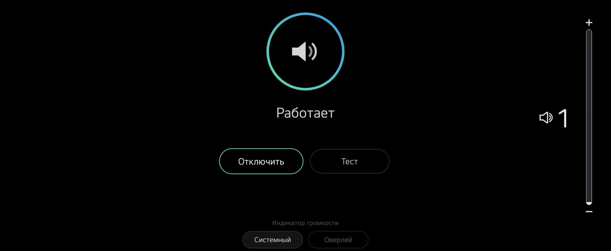
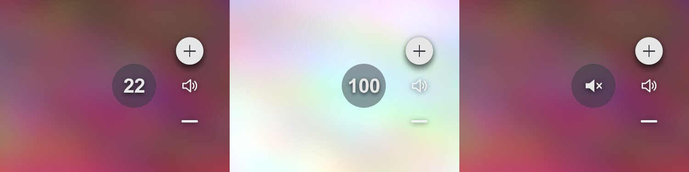
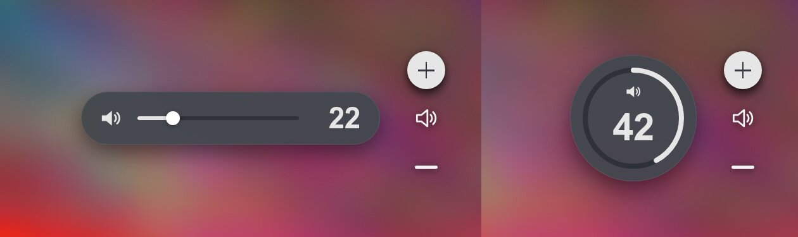
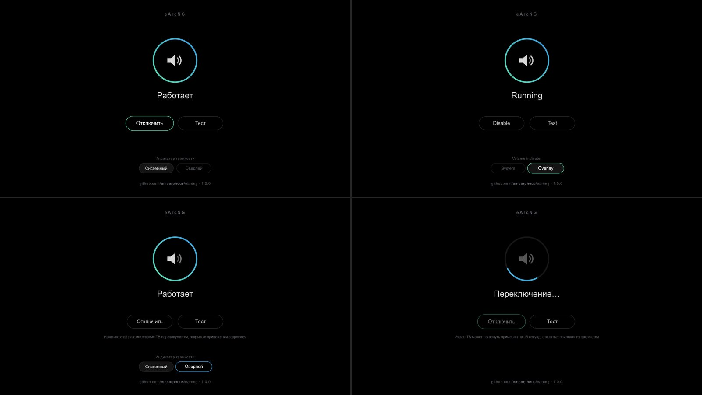

# eArcNG: реальная громкость eARC-саундбара на LG webOS

[English](README.md) · **Русский**

eArcNG (NG — Next-Gen, следующее поколение) объединяет два проекта (оба MIT):

* [trk501/lg-soundbar-volume-osd](https://github.com/trk501/lg-soundbar-volume-osd): логика CEC
  (`50:7A:xx` <Report Audio Status>, антиспам быстрых тапов через `05:45`) и **QML-патч системного индикатора**
  (webOS ≤ 10.x).
* [Nikolay1243/Webos-EARC-Volume-Overlay](https://github.com/Nikolay1243/Webos-EARC-Volume-Overlay):
  прозрачное окно-оверлей, которое не забирает фокус. У eArcNG своё приложение на этой технике
  (**eArcNG**, `com.github.emoorpheus.earcng`); приложение Nikolay1243 не нужно (его `watcher.js` без
  eARC-громкости показывает **счётчик нажатий ТВ**).

Показывается только то значение, которое саундбар сам сообщил по CEC. Есть два режима показа:

| режим | где работает | как выглядит |
|-------|--------------|--------------|
| `ui native` (рекомендуется на webOS ≤ 10.x) | QML-компоновщик: есть `StarfishVolume.qml` | **системный** индикатор LG: число и полоса вместо «+/−», появляется и гаснет сам, с нативными таймингами |
| `ui overlay` (по умолчанию) | любая прошивка, где работает приложение-оверлей (webOS 11.x с Flutter пока не проверялась) | отдельное окно-оверлей: кружок, капсула или кольцо рядом с нативной колонкой «+/−» |

Проверено (полевой тест владельца): LG OLED65M59LA (webOS 25 = 10.3.0, QML, Python 3.10.13 на ТВ) +
Sony HT-A8000 (eARC, логический адрес 5, громкость 0…100 сообщает 1:1). Оба режима: числа совпадают с
саундбаром, изменения из приложения Sony тоже показываются; в `ui native` системный индикатор показывает
реальное число и полосу сразу по нажатию, с нативными таймингами.

## Возможности

* **`ui native`**: реальное число в системном индикаторе (метод trk501, свой код). Нет второго окна, нет
  задержки запуска приложения: индикатор появляется сразу по нажатию и гаснет как обычно.
  Переключение: `./tools/earcng.sh root@TV ui native`, назад: `ui overlay`.
* **Выбор индикатора на ТВ**: кнопки «Системный» / «Оверлей» на экране настроек переключают `ui native` и
  `ui overlay`. Второе нажатие подтверждает (интерфейс ТВ перезапускается: открытые приложения закрываются, экран
  может погаснуть на ~15 с), затем экран настроек открывается снова сам и показывает итог («Готово: включён
  системный индикатор»); выбор виден, только когда мост работает и в прошивке есть QML-компоновщик
  (см. [Экран настроек](#экран-настроек)).
* **Своё приложение eArcNG** (`com.github.emoorpheus.earcng`, со значком в списке приложений): `install` собирает
  его пакет на ТВ и ставит системным установщиком (`appInstallService`), публикация в Homebrew Channel не нужна.
  Оно показывает оверлей и экран настроек.
* **Установка через Homebrew Channel** (1.1.0): добавьте репозиторий eArcNG в Homebrew Channel, установите там
  приложение и нажмите **Установить** на его экране настроек: пакет приложения несёт бэкенд
  (см. [Установка через Homebrew Channel](#установка-через-homebrew-channel-110)).
* **Второй источник громкости** (1.1.0, `--arc-source`): если CEC-шина не приносит `50:7A` (нет `/dev/cec*`, нет
  доступа, шина молчит), мост спрашивает eARC-сервис ТВ
  `luna://com.webos.service.eim/getArcVolume` (идея Nikolay1243 из v1.4.0). Это значение саундбара, как его знает
  ТВ, а не счётчик нажатий ТВ.
* **Экран настроек** в приложении eArcNG: кольцо-статус, одна кнопка «Включить/Отключить» и «Тест», почти без
  текста. Чёрный фон для OLED, подробности только при проблеме, внизу версия и ссылка на проект. **На русском
  или английском, по языку ТВ** (см. [Язык](#язык)).
* **Оверлей** (`ui overlay`): вид по умолчанию `badge` (круг Ø96 px слева от нативной колонки ARC, по центру по
  вертикали), цвета и тень по метрикам нативного индикатора. Гаснет **через 1500 мс после последнего нажатия**
  (как нативный, мост передаёт время нажатия `kt`), fade 150 мс; при появлении (холодный запуск приложения: на
  OLED65M59LA окно попадало на экран через ~0,5–1,5 с после нажатия) виден все 1500 мс от первого кадра на экране.
* `--keepalive N` (экспериментально): скрытое окно оверлея живёт ещё N секунд, следующее появление без
  холодного запуска приложения.
* Защиты native-режима: проверка патча перед монтированием, откат при сбое интерфейса, защита от обратной
  связи CEC и от отказов `setVolume`, mute ТВ и саундбара не трогается.
* **`report`**: одна команда собирает всё, что нужно для issue на GitHub (модель, прошивка, check, status, лог;
  без адреса ТВ), и для этого есть форма issue (см. [Сообщить о проблеме](#сообщить-о-проблеме)).





## Почему native быстрее и точнее

Замеры по телеметрии режима оверлея с этого ТВ (`tests/fixtures/overlay-telemetry-m59la.log`):

* нажатие на пульте → кадр ТВ `05:44` ≈ 100 мс; `05:44` → ответ саундбара `7A` ≈ 157 мс (при удержании до ~400 мс,
  часть ответов саундбар пропускает);
* каждый кадр ТВ `05:44` = ровно ±1 на саундбаре (удержание 16→27 = 11 кадров, 26→11 = 15);
* после отпускания ТВ шлёт ещё 1–2 повтора через ~250 мс.

Оверлей — отдельное веб-приложение: каждое появление после скрытия = запуск приложения, поэтому он появляется
позже нативных «+/−». Системный индикатор появляется по нажатию сам, без запуска чего-либо. Число в нём
обновляется, когда приходит ответ саундбара (~0,25 с после нажатия), до этого видно предыдущее реальное значение.

## Как работает `ui native`

```
 Пульт ─ Vol± ─► ТВ: счётчик +1 (cause volumeUp) ──► системный индикатор появляется (патч: число НЕ берёт)
                 ТВ ─ 05:44 ─► Sony ─ 50:7A:xx ─► cec_volume_bridge.py
                                                      │ luna audio/master/setVolume {"volume": xx}
                                                      ▼
                 ТВ: счётчик = xx (cause setVolume) ─► индикатор показывает xx (реальная громкость)
```

`backend/native-osd.sh apply` делает то же, что `60-volume-osd` trk501: копирует `StarfishVolume.qml` и
`StarfishVolumeView.qml` в `/tmp/cec-volume-qml`, применяет его замены `sed` и подключает копии через
`mount --bind` (файлы прошивки не меняются; после перезагрузки без хука снова оригинал), затем перезапускает
`surface-manager` (экран гаснет на несколько секунд). Замены:

1. `exterior && !syncable` → `false`: число и полоса показываются и для ARC, стрелки «+/−» уходят;
2. индикатор показывает `shownVolume` вместо живого счётчика ТВ;
3. для внешнего выхода `shownVolume` принимает только значения не от нажатий (`cause` ≠ `volumeUp/volumeDown`),
   то есть те, что выставил мост.

Правила моста (как в `cec-sync.py` trk501):

* после нажатия — всегда `setVolume` (ТВ сам насчитал то же значение, а индикатор берёт только `cause setVolume`);
* без нажатия (приложение Sony, пульт саундбара) — только если счётчик ТВ отличается;
* ТВ или саундбар в mute — ничего не трогать (`setVolume` снял бы mute); пропущенное значение выставляется сразу
  после снятия mute;
* пока подписка `getVolume` не сообщила состояние ТВ — показывает оверлей.

Защиты:

* патч монтируется, только если **все** замены сработали ровно как ожидалось (проверка trk501), иначе
  `native OSD: not applicable - <причина>` и ничего не меняется (так будет после обновления прошивки);
* если `surface-manager` после перезапуска не поднялся: размонтировать, перезапустить, файл `no-native`
  (при загрузке больше не пытаться), остаётся оверлей;
* обратная связь: если ТВ 3 раза подряд отвечает на `setVolume` кадрами громкости саундбару (`05:44`/`05:73`), хотя
  пульт не трогали ≥ 1,5 с, синхронизация выключается, штатный индикатор возвращается, `no-native`;
  то же после 3 отказов `setVolume` подряд;
* trk501 активен или QML-файлы уже смонтированы кем-то ещё — не трогать.

При загрузке хук `95-cec-volume-bridge` ставит патч в фоне (как trk501: интерфейс один раз перезапускается
через несколько секунд после старта ТВ), до этого показывает оверлей.

## Архитектура

```
 Пульт LG ── Vol± ──► CEC-стек LG ── 05:44:41/42/43 ──►  Sony HT-A8000 (лог. адрес 5)
     │                    │                                    │
     │ /dev/input/event*  │ /var/log/cecmessages (пачками)     │ 50:7A:xx  <Report Audio Status>
     │ (только чтение)    │ /dev/cec0 (MONITOR, реальное время)◄┘ (bit7 = mute, 0..100)
     ▼                    ▼
 ┌────────────── cec_volume_bridge.py (root, init.d-хук 95-cec-volume-bridge) ──────────────┐
 │ InputWatcher  нажато/отпущено Vol± (evdev, без захвата)                                  │
 │ CecBus        монитор /dev/cec0 + 05:45 "tap guard" + 05:71 контрольный запрос           │
 │ LogFollower   inotify на /var/log/cecmessages (запасной путь, ротация/усечение)          │
 │ EimPoller     --arc-source auto|eim: eim/getArcVolume, пока шина не приносит 50:7A       │
 │ AudioSubscriber  soundOutput, volume, muteStatus из audio/getVolume (PTY)                │
 │ Hub           дедупликация · лимит 0/100 · удержание · scale/max/offset · время нажатия  │
 │ NativeSink    ui native: audio setVolume (один в полёте, последнее побеждает)            │
 │ Publisher     ui overlay: applicationManager/launch (один в полёте, последнее побеждает) │
 └──────────────┬───────────────────────────────────────────────┬───────────────────────────┘
                │ luna audio/master/setVolume                   │ luna applicationManager/launch
                ▼                                               ▼ {"src":"cec","volume":22,"kt":…,"ttl":1500,"fade":150,…}
   системный индикатор (QML-патч)                         приложение eArcNG com.github.emoorpheus.earcng (FLOATING, без фокуса)
```

Антиспам (идея trk501): ТВ шлёт `05:44:41`/`42` (нажато). Если кнопку отпустили раньше, чем ТВ отправил `05:45`,
саундбар продолжает «держать» кнопку и уходит на несколько шагов. Мост видит физическое отпускание через evdev
и сразу отправляет `05:45`. Если кнопку держат дольше 0,35 с, это удержание: мост не вмешивается.
Через 0,6 с после серии нажатий мост отправляет `05:71` <Give Audio Status> и получает контрольное значение.

## Состав

```
backend/cec_volume_bridge.py   бэкенд (Python 3.6+, только stdlib); --probe, --print-config, --replay
backend/native-osd.sh          QML-патч системного индикатора: check|apply|revert|status (POSIX sh)
backend/95-cec-volume-bridge   init.d-хук Homebrew Channel (POSIX sh)
backend/remote-setup.sh        на ТВ: install|enable|disable|restart|status|log|args|ui|switch|uninstall
backend/ipk.py                 сборка пакета приложения (IPK) на ТВ, как ares-package (stdlib Python);
                               пакет несёт backend/ («Установить» / «Обновить» на экране настроек)
app/                           приложение eArcNG: appinfo.json, значки, index.html|overlay.js|overlay.css
                               (экран настроек EN/RU + OSD)
tools/earcng.sh                с ПК по SSH (Bash 3.2+, т.е. и штатный bash в macOS)
tools/make-release.py          файлы релиза: IPK, манифест Homebrew Channel, zip, SHA256SUMS (для автора)
repo.json                      репозиторий Homebrew Channel (указывает на манифест последнего релиза)
docs/hb-description.html       страница пакета в Homebrew Channel: описание (EN + RU) и картинки
tests/                         тесты без ТВ (run-all.sh), телеметрия с ТВ, QML-фикстуры, заглушка luna-send, превью
.github/ISSUE_TEMPLATE/        форма issue для отчётов о совместимости (вывод `report`)
```

## Требования

* ТВ с root (webOS Homebrew Channel, root-доступ по SSH).
* `python3` на ТВ, SIMPLINK (HDMI-CEC) включён, звук выводится через HDMI eARC/ARC.
* trk501 не активен (или отключён: `touch /home/root/volume-osd/disable && reboot`; `FORCE=1` ставит всё равно).

eARC Volume Overlay от Nikolay1243 не нужен: `install` ставит на ТВ собственное приложение eArcNG.

## Шаг 0. Проверка ТВ (ничего не меняет)

В примерах `root@TV` — замените на `root@<IP-адрес ТВ>`. Если SSH-ключ к ТВ не ключ по умолчанию,
укажите его один раз: `export SSH_KEY=~/.ssh/id_rsa_webos`.

```bash
./tools/earcng.sh root@TV check
```

Выводит `VERSION`, тип UI, bind-mount QML, python3/node, последние `RX5x7Axx`, версию приложения eArcNG (или
`not installed yet`), eARC Volume Overlay, если он установлен, хуки init.d, trk501, `soundOutput`.
Затем запускает `--probe` для `/dev/cec*` (только чтение): драйвер, возможности, логические адреса, режимы monitor
и initiator. Итоговая строка:
* `tap guard + 05:71 available`: есть монитор в реальном времени, можно отправлять кадры;
* `real-time monitor only`: только монитор;
* `log-only mode`: только лог.

Затем одно чтение eARC-сервиса ТВ (1.1.0):
* `EIM getArcVolume: Volume N - …`: второй источник громкости отвечает (`--arc-source auto` берёт его, когда
  CEC-шина не приносит `50:7A`);
* `EIM getArcVolume: unavailable (…)`: не отвечает; CEC работает как раньше.

Последняя строка — пробный QML-патч на копиях во временном каталоге (ничего не монтируется):
* `native OSD: applicable - …`: `ui native` подходит к этой прошивке;
* `native OSD: not applicable - <причина>`: остаётся оверлей.

## Шаг 1. Пробный прогон (ничего не устанавливает)

```bash
./tools/earcng.sh root@TV try 2>&1 | tee try.log
```

Бэкенд запускается из `/tmp` в dry-run на `TRY_SECONDS` (по умолчанию 90) секунд: в шину и оверлей ничего не
уходит, вместо этого печатаются `PUBLISH {...}` и `dry-run: would send 05:45`. Логи с миллисекундами и задержкой
«нажатие → ответ саундбара».

## Шаг 2. Калибровка шкалы

Мост показывает `round(raw*scale) + offset + файл offset`, ограничивая результат `0..max`. Байт после `7A`: bit7 =
mute, bits 0-6 = громкость (`RX507A16` = 22, `RX507A96` = 22 с mute, `7F` = неизвестно). HT-A8000 сообщает 0…100
1:1 — ничего настраивать не нужно. Для других саундбаров: `--max 50`, `--scale 0.5 --max 50`, `--offset -2`.
В режиме `ui native` то же значение уходит в счётчик ТВ.

## Шаг 3. Установка (оверлей)

```bash
./tools/earcng.sh root@TV install
```

`check` → загрузка → `remote-setup.sh install`:
1. проверяет root, `python3` и trk501;
2. собирает пакет eArcNG из `app/` (`backend/ipk.py`, та же структура, что у `ares-package`) и ставит его через
   `appInstallService` (как `ares-install`) в
   `/media/developer/apps/usr/palm/applications/com.github.emoorpheus.earcng`. Если ТВ откажет, больше ничего не
   меняется и печатается причина;
3. копирует бэкенд в `/home/root/cec-volume/` и хук в `/var/lib/webosbrew/init.d/95-cec-volume-bridge`;
4. если установлен eARC Volume Overlay от Nikolay1243: убирает его хук `91-earc-volume-overlay` и останавливает
   его `watcher.js`, который показывает счётчик нажатий ТВ (второй индикатор). eArcNG это приложение не нужно, его
   можно удалить в Homebrew Channel;
5. запускает мост и печатает `status` (первая строка: `running`, `stopped`, `disabled` или `missing`; строка `app:`
   — установленная версия eArcNG).

На ТВ откройте **eArcNG** из списка приложений (в сторонний лаунчер его, возможно, придётся добавить вручную):
цветное кольцо и «Работает» значат, что мост работает (см. [Экран настроек](#экран-настроек)).

Повторный `install` обновляет файлы и приложение; `args` и режим `ui` сохраняются.

## Установка через Homebrew Channel (1.1.0)

Способ без ПК. Проверено на одном ТВ (OLED65M59LA, webOS 10.3.0, Homebrew Channel 0.7.3) с тестовым
репозиторием в локальной сети: список со значком, страница приложения, INSTALL, **Установить** на экране настроек
(мост работал через ~3 с), **Обновить** после тестового пакета 1.1.1. Адрес из шага 1 берёт манифест из
последнего релиза (1.1.0 и новее); с ним Homebrew Channel показал eArcNG в списке и страницу пакета с описанием;
обновление с 1.1.0 на 1.1.1 (UPDATE, затем **Обновить** на экране настроек) и установка с нуля (INSTALL, затем
**Установить**: мост запустился меньше чем через секунду) сработали, проверено на ТВ.

1. Homebrew Channel → Settings → добавьте репозиторий
   `https://raw.githubusercontent.com/emoorpheus/earcng/main/repo.json` (поле дополнительных репозиториев).
2. Установите **eArcNG** из списка Homebrew Channel (нужен root: Root status в Homebrew Channel должен быть ok).
3. Откройте **eArcNG** из списка приложений. Экран настроек покажет «Не установлен» и кнопку **Установить**: пакет
   приложения несёт бэкенд (`backend/` в папке приложения). **Установить** запускает
   `<app>/backend/remote-setup.sh activate` от root через Homebrew Channel: те же проверки, что у `install`
   (root, `python3`, trk501), затем бэкенд копируется в `/home/root/cec-volume/`, хук — в
   `/var/lib/webosbrew/init.d/`, и мост запускается.
4. **Обновить**: когда Homebrew Channel обновил приложение и оно несёт другой бэкенд, экран настроек показывает
   **Обновить** («В приложении бэкенд X (установлен Y)»). `status` пишет то же:
   `update: backend X in the app, installed Y`. Отключённый мост после обновления остаётся отключённым
   (проверено на ТВ тестовыми пакетами 1.1.1 и 1.1.0).

Удаление: `uninstall` (с ПК или `sh /home/root/cec-volume/remote-setup.sh uninstall` по SSH) убирает QML-патч, хук,
бэкенд и приложение. Если удалить только приложение в Homebrew Channel, мост продолжит работать, но у
`ui overlay` не будет окна; в логе тогда раз в 5 минут (а не на каждое нажатие) появится
`launch rejected: … - is the eArcNG app (com.github.emoorpheus.earcng) installed?`.

Оба способа ставят на ТВ одно и то же приложение (тот же id и структура пакета, бэкенд внутри).

## Шаг 4. Системный индикатор (`ui native`, webOS ≤ 10.x)

```bash
./tools/earcng.sh root@TV ui          # текущий режим + пробный патч
./tools/earcng.sh root@TV ui native   # патч + перезапуск интерфейса (приложения закроются, ждёт ~15 с)
./tools/earcng.sh root@TV ui overlay  # убрать патч, вернуть оверлей
```

`status` показывает `ui: native (QML patch active)`. В логе моста: `native OSD patch active`, затем строки
`native setVolume 23 (key) in 40 ms` (с `--debug`). Если что-то пошло не так, причина будет в
`./tools/earcng.sh root@TV log` (`native sync OFF: …`, `native-osd: …`); `ui native` пробует снова.
«Отключить» на экране приложения (`remote-setup.sh disable`) тоже убирает патч: без моста индикатор показывал бы
устаревшее число. «Включить» ставит его снова. `ui native` при отключённом мосте только запоминает выбор, патч
ставится по «Включить». То же переключение есть на самом ТВ: кнопки «Системный» / «Оверлей» на
[экране настроек](#экран-настроек).

## Шаг 5. Настройка оверлея

```bash
./tools/earcng.sh root@TV args --variant pill        # проверка, сохранение, рестарт
./tools/earcng.sh root@TV args                       # показать текущие
./tools/earcng.sh root@TV args --clear               # по умолчанию
```

Флаги проверяются до записи (`--print-config`). Опечатка или сокращение, например `--off`, отклоняются, и `args`
остаётся прежним. Если `args` испорчен вручную, `status` покажет `stopped` и текст ошибки из
`/tmp/cec-volume-bridge.err`. Без перезапуска действуют `echo -1 > /home/root/cec-volume/offset` и
`touch /home/root/cec-volume/no-tap` (отключает `05:45`).

| флаг | назначение |
|------|------------|
| `--scale`, `--max`, `--offset N` | шкала саундбара и постоянная поправка (шаг 2) |
| `--variant badge\|pill\|ring` | круг (по умолчанию), капсула, кольцо |
| `--position` / `--pos` | `center-right` (по умолчанию, слева от колонки ARC), `center-left`, `top-*`, `bottom-*` |
| `--visible-ms 1500` | сколько видно после последнего нажатия (как нативный; после появления — всё время), 500–10000 |
| `--fade-ms 150` | появление и исчезновение, 0–1000 |
| `--keepalive N` | экспериментально: скрытое окно живёт ещё N с (0–600), повторное появление без запуска приложения |
| `--outputs a,b` / `--any-output` | при каких `soundOutput` показывать (по умолчанию: содержит `arc`) |
| `--no-tap-guard`, `--hold 0.35`, `--tap-grace` | антиспам быстрых тапов |
| `--no-final-query`, `--query-delay 0.6` | контрольный `05:71` после серии |
| `--no-prelaunch` | открывать окно только по отчёту 7A, не заранее по нажатию |
| `--no-cec-device` / `--cec-dev /dev/cec1` | только лог / другое устройство |
| `--arc-source auto\|cec\|eim` | источник громкости (1.1.0): `auto` (по умолчанию) = CEC `50:7A`, `eim/getArcVolume` ТВ — только пока шина их не приносит; `cec` = ТВ не спрашивать; `eim` = значения только из `getArcVolume` (нажатия, антиспам и `05:71` остаются) |
| `--no-input`, `--no-audio`, `--debug` | не читать пульт / без `getVolume` (тогда и без `ui native`) / подробный лог |

Режим показа задаётся командой `ui` (файл `/home/root/cec-volume/ui`), а не через `args`.



Размеры и цвета — переменные `:root` в `app/overlay.css` (`--badge-size`, `--badge-bg`, `--badge-number`,
`--osd-center-side`, `--osd-top/--osd-side/--osd-bottom`, `--osd-w/--osd-h` и др.); `install` кладёт изменённый
файл на ТВ, правки видны со следующего показа. Проверка окна без саундбара:

```bash
luna-send -n 1 luna://com.webos.applicationManager/launch \
  '{"id":"com.github.emoorpheus.earcng","params":{"src":"preview","volume":22}}'
```

## Экран настроек

Откройте **eArcNG** из списка приложений. Чистый чёрный фон (пиксели OLED не светятся), тонкие линии,
без ярких заливок.



* Кольцо показывает состояние моста: цветное = работает (строка ниже: где показывается число, системный индикатор
  или оверлей), серое = отключён или ещё не установлен (с кнопкой **Установить**), красное = остановлен или не
  установлен, а бэкенда в приложении нет, вращается = идёт команда.
* **Отключить** / **Включить** (`remote-setup.sh disable|enable`): одна кнопка, надпись следует состоянию; пока
  идёт команда, кнопка неактивна. **Тест** проигрывает короткое демо OSD и возвращает на экран.
* Подробности (последняя ошибка моста, ошибка Homebrew Channel) появляются под кнопками, только если что-то не
  так; полный статус: `./tools/earcng.sh root@TV status`. Для известных ошибок Homebrew Channel сначала идёт
  понятная подсказка (1.1.0): root-доступ не дан («проверьте Root status в настройках Homebrew Channel»), команда
  не от root, сервис Homebrew Channel не найден, работает trk501, нет `python3`; после «—» — текст ошибки ТВ.
* **Установить** / **Обновить** (1.1.0, приложение из Homebrew Channel): **Установить** стоит на месте
  «Включить», пока бэкенд не установлен, а пакет приложения его несёт; **Обновить** появляется рядом с «Тестом»,
  когда приложение несёт другой бэкенд (см. [Установка через Homebrew Channel](#установка-через-homebrew-channel-110)).
* **Индикатор громкости: Системный / Оверлей** (webOS ≤ 10.x, только когда мост работает и в прошивке есть
  QML-компоновщик): выделенная кнопка = текущий режим. Нажатие на другую просит нажать ещё раз (интерфейс ТВ
  перезапускается: открытые приложения, в том числе сторонний лаунчер, закрываются, экран может погаснуть на
  ~15 с), второе нажатие переключает (`remote-setup.sh switch native|overlay`, в фоне). На экране
  «Переключение…», статус проверяется каждые 3 с; перезапуск закрывает и это приложение. Когда интерфейс ТВ
  вернётся, экран настроек откроется снова сам и покажет итог: «Готово: включён системный индикатор» / «Готово:
  включён оверлей» (шаг виден в `/tmp/cec-volume-ui.log`: `settings screen reopened`). Если системный индикатор
  нельзя использовать
  (QML прошивки другой, включён trk501) или он не запустился (тогда остаётся оверлей), показывается причина.
* Внизу ссылка на проект и установленная версия.
* Пульт: влево/вправо между кнопками, вниз/вверх между кнопками и выбором индикатора, OK нажимает, «Назад»
  закрывает. Любая стрелка отменяет ожидающее подтверждение.

## Язык

Экран настроек (приложение **eArcNG** в списке приложений) показывается на языке меню ТВ:

* **русский** для русского и языков СНГ: русский, украинский, белорусский, казахский, киргизский, узбекский,
  таджикский, туркменский, армянский, азербайджанский, грузинский, молдавский (`mo`, `ro-MD`);
* **английский** для всех остальных языков и если язык определить не удалось.

Откуда берётся язык, по порядку: `webOSSystem.locale`, `PalmSystem.locale`, `navigator.languages[0]`,
`navigator.language`; затем его уточняет `luna://com.webos.settingsservice/getSystemSettings`
(`localeInfo.locales.UI`), если приложению разрешено это читать. Язык проверяется при каждом открытии экрана
настроек: после смены языка ТВ просто откройте приложение снова. Подробности ошибок с ТВ остаются на английском.

## Диагностика

```bash
./tools/earcng.sh root@TV status     # состояние, python3, /dev/cec*, args, ui, qml, хвост лога, последняя ошибка
./tools/earcng.sh root@TV log        # 60 строк /tmp/cec-volume-bridge.log + .err
./tools/earcng.sh root@TV monitor    # dry-run второй копией рядом с установленной
```

* `CEC monitor on /dev/cec0 (read-only)` или `transmit unavailable`: передача недоступна, tap guard и `05:71`
  выключены, показ работает.
* `remote inputs: none (tap guard inactive)`: пульт не читается из `/dev/input`.
* `sound output: … -> indicator off`: выход не похож на ARC. Используйте `--outputs <значение>` или `--any-output`.
* `native: TV volume state (getVolume) not known yet`: подписка ещё не ответила, пока показывает оверлей.
* `error: the eArcNG app was not installed (…)`: ТВ не принял пакет; причина напечатана выше, полный ответ
  `appInstallService` — в `/tmp/earcng-install.log` на ТВ. Больше ничего не менялось.
* Экран настроек не открылся снова после переключения: конец `/tmp/cec-volume-ui.log` на ТВ
  (`settings screen not reopened`); откройте eArcNG из списка приложений.
* `arc source: eim getArcVolume (<причина>)` / `arc source: CEC 50:7A (eim polling paused)`: какой источник
  громкости сейчас используется (`--arc-source`); `getArcVolume unavailable (…)`: eARC-сервис ТВ не отвечает,
  повтор через 60 с.
* `launch rejected: … - is the eArcNG app (…) installed?`: ТВ не открыл окно оверлея, обычно потому что
  приложение удалено (например, в Homebrew Channel). Пишется раз в 5 минут с числом повторов.
* `error: the eArcNG backend is not installed on this TV - …` (`restart`, `args`, `ui`, `monitor`; `log` тоже,
  если и приложения нет): установите бэкенд — `install` с ПК или **Установить** на экране настроек приложения
  eArcNG; `status` в этом случае печатает `missing`.

## Сообщить о проблеме

Работает или нет на вашем ТВ, отчёт поможет (другие ТВ, саундбары и прошивки пока не проверены):

```bash
./tools/earcng.sh root@TV report
```

Команда собирает модель и прошивку ТВ (`getSystemInfo`), установленную версию, `check` (python3, проба CEC, пробный
QML-патч), `status` и лог, сохраняет в `earcng-report.txt` (другое имя: `REPORT_FILE=…`), на macOS копирует
в буфер обмена и выводит ссылку на форму issue
([новый отчёт](https://github.com/emoorpheus/earcng/issues/new?template=report.yml)). Адрес ТВ в отчёт не
попадает; перед публикацией просмотрите текст. На ТВ ничего не меняется.

## Удаление

```bash
./tools/earcng.sh root@TV uninstall   # уберёт QML-патч, хук и приложение eArcNG
```

Если eARC Volume Overlay ещё установлен, `uninstall` снова включит его хук 91 (`watcher.js`).

## Тесты (без ТВ)

```bash
BUSYBOX=/path/to/busybox BASH32=/path/to/bash-3.2 tests/run-all.sh
NODE_PATH=/path/to/node_modules node tests/render-preview.cjs   # необязательно: PNG-превью (playwright + chromium)
```

`BUSYBOX` не должен предпочитать свои апплеты `PATH` (тесты подменяют `mount`/`umount` заглушками): подходит
статический бинарник с [busybox.net](https://busybox.net/downloads/binaries/1.35.0-x86_64-linux-musl/busybox);
`busybox-static` из Debian/Ubuntu собран с `FEATURE_PREFER_APPLETS`, и `tests/test_shell.sh` его отклонит.

* `tests/test_bridge.py`: ABI ioctl, разбор кадров, Hub, scale/offset, строгие флаги, `--probe` на фейковом ioctl,
  tap guard на фейковом `/dev/cec`, evdev, PTY-подписка `luna-send`, latest-wins, inotify; native: правила
  `setVolume`, mute ТВ/саундбара, состояние ТВ, защита от обратной связи и отказов; **прогон реальной телеметрии
  с OLED65M59LA** (в native — каждое изменение доходит до ТВ и только реальные значения; оверлей открывается в
  момент нажатия и гаснет через 1500 мс после него).
* `tests/test_shell.sh` (BusyBox ash): защита по trk501, install с приложением через фейковый `appInstallService`
  (`tests/fixtures/luna-send`: установлено, без вывода, отказ, зависание), рядом установлен eARC Volume Overlay
  (его хук и `watcher.js` выключаются, после `uninstall` включаются снова), хук, живой лог → PUBLISH, `args`,
  disable/enable/restart, SIGTERM, uninstall; `native-osd.sh` на синтетических QML: результат замен побайтно
  совпадает с выводом команд trk501, откат при сбое `surface-manager`, `no-native`, изменённая прошивка, нет QML
  (Flutter), чужой bind-mount, фоновая установка патча хуком, `ui native` end-to-end (dry-run, фейковый
  `getVolume`: счётчик ТВ 17 → 20 → 21 по нажатию, оверлей не запускается); `switch` с экрана настроек:
  `switching`, пока идёт в фоне, без параллельного запуска, причины в `switch error:`, строка `qml:`,
  `ui native` при отключённом мосте только запоминает выбор, экран настроек снова открывается после переключения
  (и после неудачного); `uninstall` удаляет приложение.
* `tests/test_installer.sh`: `check` (с пробой QML-патча), `install` с `FORCE`, `args`, `ui`, `try`, `report`
  (файл = вывод, модель, версии, status, лог, без адреса ТВ, буфер обмена), `uninstall` через заглушку ssh, в том
  числе под bash 3.2.57.
* `tests/test_ipk.py`: пакет из `backend/ipk.py`: члены `ar`, `control`, пути и права в `data.tar.gz`,
  `packageinfo.json`, одинаковые байты при каждой сборке, скрытые файлы пропускаются, `same`, `backend/` внутри.
* `tests/test_release.py`: `tools/make-release.py` во временном git-репозитории: IPK и zip — из тега, манифест
  (хеш, размер, адреса), `SHA256SUMS`, отказы (версии, тег, CHANGELOG, release notes), тестовый репозиторий
  (`--base-url`); `repo.json` совпадает; страница пакета (`docs/hb-description.html`) начинается с `<p>`, её
  картинки — файлы репозитория.
* EIM и Homebrew Channel (1.1.0): `tests/test_bridge.py` (ответ `getArcVolume`, частота опроса, `auto` / `cec` /
  `eim`, mute, то же значение после нажатия, `Unavailable`, `--probe`, лог без повторов `launch rejected`),
  `tests/test_shell.sh` (только пакет приложения: `status` предлагает «Установить» / «Обновить», `activate`,
  отключённый мост остаётся отключённым, ТВ без `cmp`, отказы), `tests/test-overlay.cjs` (кнопки и команды
  «Установить» / «Обновить», подсказки к ошибкам Homebrew Channel на EN/RU).
* `tests/test-overlay.cjs`: жизненный цикл оверлея (приём/отбрасывание, позиции, тайминги 1500/150, `kt`,
  keepalive, закрытие окна); экран настроек: статус и кнопка для каждого ответа `status`, занятость, поздние
  ответы, навигация пультом, версия внизу = версия моста; выбор индикатора: когда виден, подтверждение, команда
  `switch`, опрос во время переключения, ошибки, строка «Готово» после повторного открытия; язык: 29 локалей,
  порядок источников, ответ и отказ `settingsservice`; приложение: `appinfo.json`, значки 130/256 px, один и тот же
  id приложения везде.

CI (`.github/workflows/tests.yml`) запускает `tests/run-all.sh` с `REQUIRE_ALL=1` (пропущенный набор = провал).

## Ограничения

* `ui native` проверен на одном ТВ (OLED65M59LA, 10.3.0). Замены trk501 рассчитаны на webOS ≤ 10.x с QML
  (trk501 сообщает о работе на 10.3.1/10.3.2); подходят ли они к другой прошивке, покажет `check`
  (строка `native OSD:`). Если не подходит, ничего не монтируется и остаётся оверлей.
* Число в системном индикаторе обновляется с ответом саундбара (~0,25 с после нажатия, при удержании до ~0,4 с),
  до этого видно предыдущее реальное значение.
* При каждой загрузке в режиме `ui native` интерфейс один раз перезапускается (как у trk501).
* Не проверялось на реальном ТВ: webOS 11.x (Flutter; там нет QML, поэтому `ui native` неприменим), другие ТВ и
  саундбары, `--keepalive`. Метрики круга (Ø96, `#373A41` 50 %, отступ 45 px) взяты из описания QML и с прошивкой
  не сверены.
* Определение языка проверено на одном ТВ (OLED65M59LA, 10.3.0: язык меню русский и английский); на других ТВ
  пока нет. Если определить не удалось, экран будет на английском.
* 1.1.0 проверена на одном ТВ (OLED65M59LA, 10.3.0, Homebrew Channel 0.7.3) по SSH, без пульта: источник EIM
  (`eim` и `auto` без CEC-устройства: значение через 0,18–0,4 с после шага; в быстрой серии промежуточные
  значения могут пропускаться, последнее верное), установка из Homebrew Channel с тестовым репозиторием,
  «Установить» / «Обновить» на экране настроек. Ещё нет: `auto`, когда шина работает, а саундбар молчит.
* 1.1.1 (документация): с адресом из `main` Homebrew Channel 0.7.3 показал eArcNG в списке и страницу пакета
  с описанием и тремя картинками; после двух перезагрузок ТВ хук запускал 1.1.0 (через 36–39 с после старта,
  патч родного индикатора активен). После релиза — обновление с этого адреса: UPDATE 1.1.0 → 1.1.1 в Homebrew
  Channel, затем «Обновить» на экране настроек (мост 1.1.1 запустился через 1,2 с после остановки старого, патч
  родного индикатора остался активен, ТВ не перезагружался).
* 1.1.2 (документация), на том же ТВ с саундбаром по eARC: установка с нуля с адреса из `main` (INSTALL, затем
  «Установить»: мост запустился меньше чем через секунду с оверлеем, он по умолчанию; «Системный» на экране
  настроек включил системный индикатор); подсказка про trk501 при «Установить» (с процессом-заменой с командной
  строкой trk501, не с самим trk501; ничего не установилось); mute при `eim` (mute пришёл от ТВ через 13–21 мс
  после кнопки, значение ТВ не трогалось, был значок mute LG; пока на ТВ заставка, первое нажатие только будит
  экран); standby (кнопка питания → Active Standby, мост продолжал работать; после Wake-on-LAN по Wi-Fi системный
  индикатор показывал верные значения). Остальные подсказки к ошибкам Homebrew Channel на ТВ ещё не появлялись.
  После релиза: UPDATE 1.1.1 → 1.1.2, затем «Обновить» на экране настроек (мост 1.1.2 запустился через 0,7 с
  после остановки старого, патч остался активен). Ещё нет: `auto`, когда шина работает, а саундбар молчит (нужен
  саундбар, который не отвечает), webOS 11, другие ТВ.
* Приложение eArcNG (установка через `appInstallService`, значок в списке приложений, `uninstall` и установка
  с нуля), экран настроек и выбор индикатора на нём (переключение в обе стороны,
  подтверждение, отмена, повторное открытие экрана с итогом) проверены на одном ТВ (OLED65M59LA, 10.3.0, с лаунчером
  Hearth: открытый снова экран остаётся сверху); на других ТВ и лаунчерах пока нет.

## Благодарности и лицензия

eArcNG, автор [emoorpheus](https://github.com/emoorpheus). Основан на:

* [trk501/lg-soundbar-volume-osd](https://github.com/trk501/lg-soundbar-volume-osd): логика CEC, антиспам `05:45`,
  метод QML-патча системного индикатора (`sed`-замены воспроизведены, код свой).
* [Nikolay1243/Webos-EARC-Volume-Overlay](https://github.com/Nikolay1243/Webos-EARC-Volume-Overlay): исходное
  приложение-оверлей и его техника плавающего окна без фокуса, на которой построено приложение eArcNG; источник
  `eim/getArcVolume` и устройство репозитория Homebrew Channel (v1.4.0).
Разработано с помощью ИИ-ассистентов (Claude, Gemini, ChatGPT); проверено автором на реальном ТВ (см. «Ограничения»).

Лицензия MIT, см. [LICENSE](LICENSE). Проект не связан с LG Electronics и Sony; LG, webOS и Sony — товарные знаки
их владельцев. Используете root-доступ к ТВ на свой риск.
